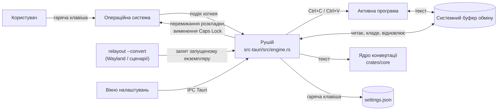

# 📘 Relayout

Цей документ містить основну інформацію про проєкт: призначення, архітектуру, локальний запуск, розгортання, доступи та підтримку.

| Поле | Значення |
| :---- | :---- |
| **Тип** | `Internal Tool` (настільна програма для macOS, Windows і Linux) |
| **Статус** | `Актуальний`&nbsp; |
| **Власник документа** | Oleksandr Sitnitskyi |
| **Версія документа** | `1.0` |
| **Оновлено** | `2026-11-10` |

> 📌 **Де зберігається:** основна версія — у репозиторії GitHub (`README.md`). Зміни вносяться спочатку в GitHub.

---

## 📑 Зміст

1. [Паспорт проєкту](#passport)  
2. [Функціонал та користувацька документація](#user-guide)  
3. [Посилання та дизайн](#links-design)  
4. [Архітектура та середовища](#architecture)  
5. [Технічна реалізація](#technical)  
6. [Репозиторій та CI/CD](#cicd)  
7. [Безпека та доступи](#security)  
8. [Моніторинг та підтримка](#operations)  
9. [Резервне копіювання та відновлення](#recovery)  
10. [Історія змін документації](#history)

---

<a id="passport"></a>

## 1\. 🪪 Паспорт проєкту

| Поле | Значення |
| :---- | :---- |
| **Назва / короткий опис** | Relayout — програма в треї / рядку меню, яка за гарячою клавішею виправляє текст, набраний не в тій розкладці (`ghbdsn` → `привіт`) або з увімкненим Caps Lock (`пРИВІТ` → `Привіт`). |
| **Призначення та бізнес-цінність** | Хто багато листується українською та англійською, регулярно набирає речення не в тій розкладці й мусить його стирати та набирати заново. Relayout виправляє такий текст одним натисканням, не читаючи постійно клавіатуру і нічого не передаючи в мережу. |
| **Бізнес-власник / ініціатор** | Oleksandr Sitnitskyi, `TODO` *(роль / команда / контакт)* |
| **Технічний власник** | Oleksandr Sitnitskyi, `TODO` *(роль / команда / контакт)* |
| **Команда розробки / підтримки** | `TODO` |
| **Короткий опис стеку** | Rust, Tauri 2; вікно налаштувань — HTML / CSS / JavaScript без фреймворків. |
| **Цільові користувачі / підрозділи** | Усі працівники, які пишуть українською та англійською. `TODO` *(конкретні підрозділи, якщо потрібно)* |
| **Дата запуску** | `2026-11-10` (перша робоча версія) |

---

<a id="user-guide"></a>

## 2\. 👥 Функціонал та користувацька документація

### 🎯 Для чого проєкт:

Буває, що набираєш лист, дивишся на екран, а там `ghbdsn, zr cghfdb?` замість «Привіт, як справи?», бо забув перемкнути мову. Relayout виправляє це одним натисканням гарячої клавіші: не треба стирати текст, перемикати розкладку й набирати все заново.

### ⚙️ Основні можливості:

* **Виправлення розкладки.** Виділений текст (або останнє слово, якщо нічого не виділено) перекладається в іншу розкладку: `ghbdsn` → `привіт`, `руддщ` → `hello`. Після цього система сама перемикається на правильну мову.  
* **Виправлення Caps Lock.** `пРИВІТ, ЯК СПРАВИ` → `Привіт, як справи`, після чого Caps Lock вимикається. Якщо текст ще й набрано не в тій розкладці (`gHBDSN`), обидві помилки виправляються одним натисканням.  
* **Змішаний текст.** Правильно набрані слова у виділенні не чіпаються: `Привіт, zr cghfdb&` → `Привіт, як справи?`.  
* **Відкат.** Повторне натискання повертає текст назад, якщо розкладку виправлено помилково.  
* **Приватність.** Програма не стежить за клавіатурою, не має мережевої частини й нічого не зберігає (див. [розділ 7](#security)).

### 🚀 Як почати роботу:

1. **Отримайте доступ:** інсталятор для своєї системи (`.dmg` / `.app` для macOS, `setup.exe` для Windows, `.deb` / `.rpm` / AppImage для Linux) поки що можна отримати в технічного власника. `TODO` — посилання на GitHub Releases, коли їх буде налаштовано.  
2. **Ознайомтеся з основним сценарієм роботи:** [docs/user-guide.md](docs/user-guide.md) — встановлення, перший запуск, налаштування, обмеження та типові проблеми.

---

<a id="links-design"></a>

## 3\. 🔗 Посилання та дизайн

| Ресурс | Посилання |
| :---- | :---- |
| **Production URL** | `N/A` — настільна програма, вебчастини немає |
| **Stage / Test URL** | `N/A` |
| **Репозиторій з кодом** | `TODO` *(URL на GitHub)* |
| **Документація для користувачів** | [docs/user-guide.md](docs/user-guide.md) |
| **Документація для розробників** | [docs/development.md](docs/development.md) |
| **Дизайн / Figma / макети** | `N/A` |
| **Технічне завдання / SRS** | `N/A` |
| **API / Swagger / OpenAPI** | `N/A` — мережевого API немає; єдиний інтерфейс командного рядка описано в [розділі 5](#technical) |
| **Діаграма архітектури** | [Розділ 4](#architecture) цього документа |
| **Дошка задач / релізів** | `TODO` / `N/A` |

---

<a id="architecture"></a>

## 4\. 🏗️ Архітектура та середовища

**Опис потоків:** Relayout працює лише на компʼютері користувача, без сервера й мережевих зʼєднань. Операційна система повідомляє програму про натискання гарячої клавіші. Програма надсилає в активне вікно `Ctrl+C` / `⌘C`, читає скопійований текст із буфера обміну, виправляє його, кладе результат у буфер і надсилає `Ctrl+V` / `⌘V`. Після цього вона повертає попередній вміст буфера й перемикає системну розкладку. Вікно налаштувань спілкується з програмою лише через внутрішній IPC Tauri.



&nbsp;

### 🌐 Середовища:

| Середовище | URL / endpoint | Призначення | Відповідальний |
| :---- | :---- | :---- | :---- |
| **Production** | `N/A` — інсталятори на компʼютерах користувачів | Робоче | `TODO` |
| **Stage** | `N/A` | QA / тестування | `N/A` |
| **Development** | Локальний запуск `pnpm dev` | Розробка | Розробник |

### ☁️ Інфраструктура:

Хмарної та серверної інфраструктури немає: програма повністю локальна.

| Ресурс | Ім'я / ID | Регіон / VPC / subnet | Доступ / SG / порт | Призначення |
| :---- | :---- | :---- | :---- | :---- |
| **Cloud / акаунт / проєкт** | `N/A` | `N/A` | `N/A` | `N/A` |
| **EC2 / VM / контейнер** | `N/A` | `N/A` | `N/A` | `N/A` |
| **RDS / Cloud SQL / база даних** | `N/A` | `N/A` | `N/A` | `N/A` |
| **Storage / S3 / Cloud Storage** | `N/A` | `N/A` | `N/A` | `N/A` |
| **DNS / CDN / WAF** | `N/A` | `N/A` | `N/A` | `N/A` |

---

<a id="technical"></a>

## 5\. 🛠️ Технічна реалізація

### 🧱 Стек:

- **Rust** (stable; перевірено на 1.99) — уся логіка.
- **Tauri 2.12** — трей / рядок меню, вікно налаштувань, гарячі клавіші, автозапуск, інсталятори.
- **HTML / CSS / JavaScript** без фреймворків — вікно налаштувань.
- **Node.js + pnpm** — лише для Tauri CLI під час збірки.
- **Python 3** — лише для генерації статистики пар літер (`tools/`), у збірці не потрібен.

### 🧩 Компоненти та модулі:

| Модуль | Відповідальність |
| :---- | :---- |
| `crates/core` | Ядро: визначення напрямку, конвертація між розкладками, розпізнавання Caps Lock. Без залежностей і без вводу-виводу. |
| `crates/core/src/layouts.rs` | Таблиці розкладок: символи 47 клавіш для кожної розкладки. |
| `crates/core/src/bigrams.rs` | Статистика пар літер англійської та української; згенерована `tools/bigrams.py`. |
| `src-tauri/src/main.rs` | Запуск програми, трей, реєстрація гарячої клавіші, команди для вікна налаштувань, `--convert`. |
| `src-tauri/src/engine.rs` | Сценарій після натискання: копіювання, конвертація, вставка, відновлення буфера, перемикання розкладки. |
| `src-tauri/src/platform/macos.rs` | macOS: натискання через CGEvent, розкладки через Text Input Sources, Caps Lock через IOKit. |
| `src-tauri/src/platform/windows.rs` | Windows: натискання через SendInput, розкладки через HKL, Caps Lock. |
| `src-tauri/src/platform/linux.rs` | Linux (X11): натискання через XTest, розкладки й Caps Lock через XKB; таблиці читаються з розкладки X-сервера. |
| `ui/` | Вікно налаштувань: гаряча клавіша, автозапуск, підказка про дозвіл на macOS. |
| `tools/` | Генерація статистики пар літер. |

### 🔌 Залежності та зовнішні сервіси:

Зовнішніх сервісів, API, баз даних і черг немає. Програма не виконує мережевих запитів.

Основні бібліотеки: `tauri`, `tauri-plugin-global-shortcut`, `tauri-plugin-autostart`, `tauri-plugin-single-instance`, `arboard` (буфер обміну), `zeroize` (затирання тексту в памʼяті); за платформами — `core-graphics` / `core-foundation` (macOS), `windows-sys` (Windows), `x11rb` (Linux).

### 💻 Локальний запуск:

Передумови: Rust, Node.js, pnpm; на Windows — Microsoft C++ Build Tools; на Linux — WebKitGTK та системні бібліотеки. Детально, разом зі скриптами `build-windows.bat` і `build-linux.sh`: [docs/development.md](docs/development.md).

```sh
pnpm install     # Tauri CLI
pnpm dev         # запуск у режимі розробки
pnpm build       # збірка інсталятора для поточної ОС
```

### 🔑 Конфігурація та змінні оточення:

Під час роботи програма не читає змінних оточення і не має секретів. Єдине налаштування — гаряча клавіша — зберігається у `settings.json` у теці налаштувань користувача (шляхи — у [docs/user-guide.md](docs/user-guide.md#налаштування)).

| Назва змінної | Опис | Джерело значення | Приклад для локального `.env` |
| :---- | :---- | :---- | :---- |
| `RELAYOUT_YES` | Лише для `build-linux.sh`: встановлювати відсутні інструменти без запитання | Задається вручну під час збірки | `RELAYOUT_YES=1` |

> ⚠️ **Важливо:** значення секретів у документації не вказуються. Тільки назва змінної та місце зберігання.

### 📡 API та контракти:

Мережевого API немає. Інтерфейс командного рядка:

| Команда | Що робить |
| :---- | :---- |
| `relayout` | Запускає програму. Якщо вона вже запущена, відкриває вікно налаштувань. |
| `relayout --convert` | Просить уже запущений екземпляр виконати конвертацію, як після натискання гарячої клавіші. Текст не передається. Потрібна там, де програма не може слухати гарячі клавіші сама (Linux / Wayland). |

### 🧪 Тестування:

Автоматичні модульні тести ядра (конвертація, Caps Lock, типографські лапки, перевірка таблиць розкладок). Умова успіху — усі тести проходять. Взаємодія з ОС (гарячі клавіші, буфер обміну, перемикання розкладки) перевіряється вручну за чеклістом у [docs/development.md](docs/development.md#ручна-перевірка).

```sh
pnpm test        # те саме, що cargo test -p relayout-core
```

---

<a id="cicd"></a>

## 6\. 🔄 Репозиторій та CI/CD

| Поле | Значення |
| :---- | :---- |
| **URL репозиторію** | `TODO` |
| **Основна гілка та правила PR** | `main`. `TODO` — правила PR і рецензування. |
| **CI workflow / pipeline** | `N/A` — не налаштовано. Інсталятори збираються вручну на кожній ОС (`pnpm build`, `build-windows.bat`, `build-linux.sh`). |
| **Registry / назва образу** | `N/A` |
| **Як відбувається деплой** | Розробник збирає інсталятори на macOS, Windows і Linux і передає їх користувачам. `TODO` — публікація в GitHub Releases. Порядок: [docs/development.md](docs/development.md#випуск-версії). |
| **Як перевірити реліз / healthcheck** | Встановити інсталятор і пройти ручний чекліст із [docs/development.md](docs/development.md#ручна-перевірка). |
| **Як відкотити версію** | Встановити інсталятор попередньої версії поверх поточної. Якщо його немає, зібрати з тегу: `git checkout vX.Y.Z && pnpm build`. Теги версій ставляться під час випуску (див. [docs/development.md](docs/development.md#випуск-версії)). |
| **Хто може деплоїти** | `TODO` |

---

<a id="security"></a>

## 7\. 🔐 Безпека та доступи

| Поле | Значення |
| :---- | :---- |
| **Публічність застосунку** | `Internal` — настільна програма без мережевої частини. Схема захисту через Cloudflare / 2FA до неї не застосовується: доступ ззовні неможливий, бо немає жодного сервера чи порту. |
| **Авторизація / SSO / Zero Trust** | `N/A` |
| **Хто погоджує доступ** | `TODO` |
| **Як надати / відкликати доступ** | Надати — передати інсталятор. Відкликати — видалити програму з компʼютера. |
| **Мережеві обмеження / SG / firewall** | `N/A` — програма не відкриває портів і не виконує вихідних запитів. Вікно налаштувань обмежене політикою CSP `default-src 'none'`. |
| **Місце зберігання секретів** | `N/A` — секретів немає. |

### 🛡️ Захист даних користувача:

Програма працює з текстом, який набирає користувач, тому дотримується таких правил:

- **Не стежить за клавіатурою.** Натискання не перехоплюються: система повідомляє програму лише про натискання гарячої клавіші.
- **Нічого не передає.** У коді немає мережевих запитів, оновлень чи телеметрії.
- **Нічого не зберігає.** Текст перебуває в памʼяті лише під час однієї конвертації, після чого затирається (`zeroize`). Логів немає. На диск записується тільки `settings.json` з гарячою клавішею.
- **Буфер обміну.** Виправлений текст кладеться в буфер із позначкою «прихований», тож менеджери та історія буфера (`Win+V`, хмарна синхронізація, Klipper тощо) його пропускають. Попередній вміст буфера повертається одразу після вставки.
- **Мінімум прав.** На macOS потрібен лише дозвіл «Універсальний доступ» (для `⌘C` / `⌘V`); «Моніторинг введення» не запитується. На Windows і Linux додаткових прав не потрібно.
- **Вікно налаштувань ізольоване.** Йому не надано доступу до файлів, оболонки чи буфера обміну, лише до чотирьох команд програми.

Відоме обмеження: виділений, ще не виправлений текст кладе в буфер сама активна програма, без позначки «прихований». Він лежить там частки секунди.

Інсталятори поки не підписані: macOS і Windows показують попередження під час першого запуску. Для широкого розповсюдження потрібні Apple Developer ID і сертифікат підпису коду для Windows (`TODO`).

### 🌍 Типи публічності:

| Тип | Як захищено |
| :---- | :---- |
| `Public` | Доступний з інтернету, вхід захищено двофакторною автентифікацією (2FA) |
| `Internal` | Схований від інтернету через Cloudflare, доступ лише для авторизованих користувачів |

### 🗝️ Реєстр секретів (без значень):

| Назва змінної | Сховище / шлях | Хто керує |
| :---- | :---- | :---- |
| `N/A` — секретів немає | `N/A` | `N/A` |

> ⚠️ **Важливо:** правила роботи з секретами описані в документі **«Робота з секретами»**. Паролі, токени й ключі в README, Google Docs та коментарях до коду не зберігаються.

---

<a id="operations"></a>

## 8\. 📈 Моніторинг та підтримка

| Поле | Значення |
| :---- | :---- |
| **Healthcheck** | `N/A` — працюючу програму видно за іконкою «Aя» в треї / рядку меню. |
| **Логи та місце перегляду** | Свідомо не ведуться, щоб текст користувача ніде не зберігався. Для діагностики програму запускають з термінала (`pnpm dev` або виконуваний файл напряму) і дивляться вивід. |
| **Метрики / dashboard** | `N/A` |
| **Алерти та отримувачі** | `N/A` |
| **Відповідальний за інциденти** | `TODO` |
| **Канал підтримки** | `TODO` |
| **Типові проблеми / runbook** | [docs/user-guide.md](docs/user-guide.md#типові-проблеми) |

---

<a id="recovery"></a>

## 9\. 💾 Резервне копіювання та відновлення

| Ресурс | Спосіб і частота | Retention | Відновлення / тест |
| :---- | :---- | :---- | :---- |
| **База даних** | `N/A` | `N/A` | `N/A` |
| **Файли / об'єкти** | `N/A` — дані користувача не зберігаються. `settings.json` містить лише гарячу клавішу; якщо його втратити, буде типова `Ctrl+Shift+Space`. | `N/A` | Задати гарячу клавішу заново у вікні налаштувань. |
| **Конфігурація / IaC** | Код і конфігурація збірки — у Git-репозиторії на GitHub. | Уся історія Git | Клонувати репозиторій і зібрати за [docs/development.md](docs/development.md). |

---

<a id="history"></a>

## 10\. 📝 Історія змін документації

| Дата | Автор | Що змінено |
| :---- | :---- | :---- |
| `2026-11-10` | Oleksandr Sitnitskyi | Створено документацію за шаблоном |

&nbsp;
